<p align="center">
  
</p>
<h1 align="center">Antille</h1>
<p align="center">Make the Mac’s island your own.</p>
<p align="center">
  
  
  
</p>

Antille is a native island engine, a standalone creator app, and a command-line client. Build a custom island with SwiftUI, or publish activities from another app or script through its private local socket.

The surface stays black to join the camera cutout. It expands for useful content, stretches toward dragged items, and ripples when they land. On a notchless screen it sits at the top center. Reduce Motion removes deformation and animated geometry changes.

## Install

Download the Apple Silicon preview from [Releases](https://github.com/Upsidedly/antille/releases) and move `Antille.app` to `/Applications`. Preview bundles are locally signed development builds, not Developer ID signed or notarized. The Swift package can also be built from source below.

## Use the creator

Open Antille from the menu bar to configure a saved profile: size, curves, activation, display, content order, and custom blocks. **Apply** saves atomically; **Share** imports, exports, or recovers the previous save. Hover or click the island to expand it, pin it to keep it open, and press Escape to collapse it. A consumer can require a click: hover then gives only a small invitation, and a clicked surface stays open until an outside click or Escape.

Clicking the selected compact item again closes it, including a pinned selection. Clicking another compact item switches content and preserves the pin.

Expanded content keeps its layout while the black shell changes shape. Short content fits its natural height; local drafts survive closing and reopening. The compact overflow and expanded **All activities** menus reach items outside the visible row.

Blocks support text, symbols, images, sprites, progress, timers, buttons, toggles, text input, native choices, rows, columns, and lists. [Pikminions](https://github.com/Upsidedly/pikminions) uses the same engine for animated agent heads, conversations, magnetic docking, and extraction.

## Everyday utilities

The creator opens to **Utilities**. Music and power can be enabled independently; these preferences apply immediately across profiles. The menu-bar menu also jumps directly to each utility in the island.

- **Sticky note:** save a local note and show its first line as text on the right wing of the compact island. Click it to read or edit the whole note; Save commits an edit and Cancel preserves the saved text. Hide it from the compact bar without deleting it. The note and visibility survive app restarts.
- **Music:** Spotify and Apple Music now playing, previous/play-pause/next, optional Spotify artwork, and progress when the player supplies a position. Choose a player or let Antille follow playback changes. A closed player stays closed until you choose Open. Background checks never request Automation access; an explicit playback control may prompt once. Denied access has an Automation settings link.
- **Timer:** 5/15/25-minute presets or custom minutes, pause/resume/cancel, restart and a completion state. Its saved deadline survives app restarts and sleep. System banners follow the existing profile notification setting.
- **Power:** real battery level, AC/charging state, Low Power Mode and available time estimates. Unknown values are omitted.

Playing music, a visible saved note and an active, paused or completed timer may occupy compact slots. Battery status appears there only when low or briefly after a power-source change, and can be disabled entirely in Utilities. The expanded roster retains idle utilities alongside agent heads. Hover invites a click; utility controls open by click. Text reserves its measured width and grows toward the right; the physical camera cutout stays clear. Existing bounded overflow is used; Antille does not probe other apps' menu positions or request Accessibility access to find unused space.

The [provenance notes](PROVENANCE.md) record the implementation's reference sources. The implementation adds no account, media web API, private MediaRemote dependency or copied third-party code.

## Build

Requires macOS 14+ and a Swift 6 toolchain.

```sh
python3 scripts/build.py --release
open dist/Antille.app
```

This creates the app, its icon, and `dist/antille`, signed locally for development. Omit `--release` for a debug build. The scripts use the selected toolchain without changing your Xcode selection.

To open the installed app automatically, add `/Applications/Antille.app` in **System Settings → General → Login Items & Extensions → Open at Login**. Login-item registration is a user setting; building the app does not change it.

## Publish an activity

```sh
dist/antille pair --producer my.tool
# Approve my.tool in the creator’s Sources tab, then repeat the pair command.
dist/antille publish --producer my.tool --id build --title 'Building' --progress 0.4
dist/antille publish --producer my.tool --id build --title 'Ready'
dist/antille clear --producer my.tool --id build
```

`dist/antille --help` lists commands. Publish a complete `IslandActivity` document with `publish --file ACTIVITY.json`; `list` shows the serialized shape. Producers receive named actions with form fields and optional screen positions, and acknowledge them after handling them.

## Embed it

Add this directory as a local Swift package dependency and import `Antille`.

```swift
import Antille

@MainActor
func makeIsland() throws -> IslandController {
    let store = IslandStore()
    try store.upsert(IslandActivity(
        producerID: "my.app", activityID: "download",
        title: "Downloading", progress: 0.4, symbol: "arrow.down"
    ))
    let controller = IslandController(store: store)
    controller.show()
    return controller
}
```

Retain the controller for the surface’s lifetime. Custom compact and expanded SwiftUI providers can replace the default content. The engine supplies safe landing slots, dedicated drop mode, magnetic deformation, extraction previews, overflow, focus events, and accessible actions. Hover + Down on an extractable head invokes its named detach action; the arrow is released outside eligible regions and during native menus. Consumer apps own their data and domain behavior.

Custom views can use `islandContextMenu` with `IslandContextMenuItem` actions, checked states and submenus. It builds one native menu per opening so live SwiftUI updates preserve its choices; lifecycle callbacks let a consumer pause source motion until the menu closes. Right-click, Control-click and the accessible Show menu action are supported.

Text blocks can opt into Markdown and smooth arriving-text fades. The native renderer handles headings, emphasis, links, lists, quotes, fenced code and tables, with bounded scrollable previews. It does not fetch remote images or execute HTML. Consumer activities can also put secondary actions into an always-visible menu, request room for a taller form, and supply timestamped one-shot sprite packs. See the integration guide for these optional fields.

See [the integration guide](docs/integration.md) for native APIs, forms, handoff semantics, and the versioned local protocol.

## Privacy and boundaries

The host uses a private Unix-domain socket under `~/Library/Application Support/Antille`. It checks the peer user, requires approved scoped producer tokens, bounds payloads and requests, and rejects stale generations/revisions. The host does not execute producer shell commands.

Credentials use silent Keychain access and fail closed when interaction would be required. There is no plaintext fallback or automatic approval of security prompts. Profiles and permitted assets stay local. This is an unsandboxed development build; sandboxed-client transport has not been established.

Media integration reads playback metadata from the selected local player. Optional artwork is fetched only over HTTPS from allowlisted Spotify image hosts, with bounded decoding and no disk cache. Track metadata is held in memory, not archived. Native power readings require no additional permission.

Development builds keep credentials under their signing identity. Relaunching an unchanged build restores access; after rebuilding locally, pair sources again. This preserves older Keychain permissions and avoids credential prompts.

Each controller targets one display. Simultaneous host islands on multiple displays, login-item registration, quiet hours, notarization, and public distribution are outside the current implementation.

## Development

```sh
swift build
swift run AntilleChecks --fixture
python3 scripts/check-utilities.py
python3 scripts/check-utility-island.py
python3 scripts/check-island-fluidity.py
python3 scripts/check-hover-arrow-recovery.py
python3 scripts/build-interaction-fixture.py
python3 scripts/build-utilities-fixture.py
python3 scripts/build.py --fixture
open dist/AntilleFixture.app
```

Fixtures use a separate bundle, preferences, profiles, socket, and RAM-only credentials. Pair AntilleFixture with PikminionsFixture through the UI. Separate CLI processes cannot retain RAM pairing state.

`AntilleUtilitiesFixture.app` is a separate sample-only window for playback, timer, power and narrow/error layouts. It starts no socket, contacts no player or T3 server, and requests no permission. The utility checks cover domain state, bounded AppleScript subprocesses and synthetic authorization recovery; the floating-panel check runs repeated consumer transitions under the actual SwiftUI app lifecycle.

The runtime implementation is independently written. The icon is authored in `scripts/make-icon.swift`. Native fixture checks use isolated sample consumers; they do not establish every display, oldest supported runtime, or physical pointer/keyboard combination. See [provenance](PROVENANCE.md) for reference boundaries.

## License and contact

[Mozilla Public License 2.0](LICENSE). Copyright © 2026 Matthew Williams.

Questions and rights concerns: [matthewlloydw@gmail.com](mailto:matthewlloydw@gmail.com).
